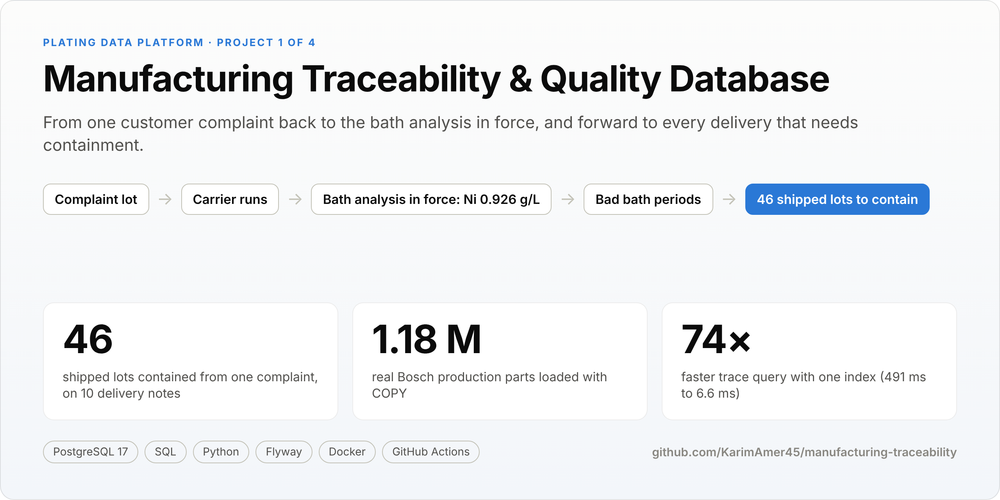
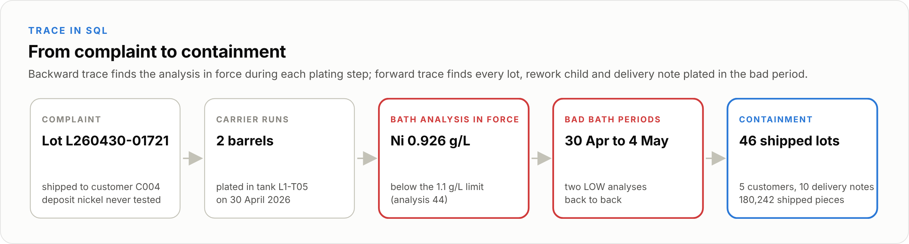
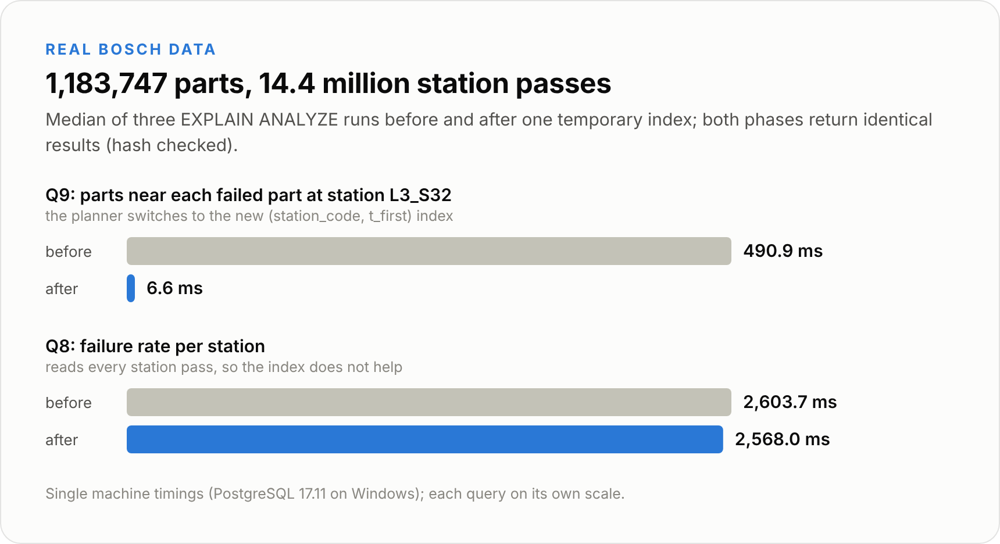
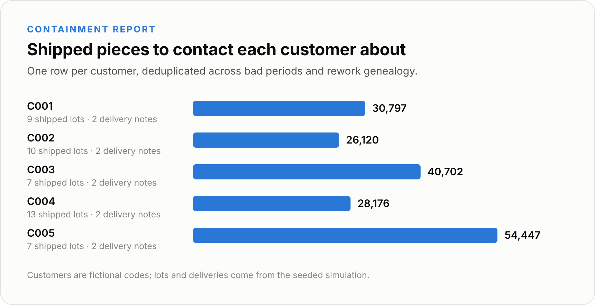

<p align="center"></p>

<p align="center"><a href="https://github.com/KarimAmer45/manufacturing-traceability/actions/workflows/ci.yml"></a>   </p>
<p align="center">Plating Data Platform: <b>Traceability</b> &middot; <a href="https://github.com/KarimAmer45/process-quality-analytics">Lab ETL & SPC</a> &middot; <a href="https://github.com/KarimAmer45/industrial-iot-historian">IoT historian</a> &middot; <a href="https://github.com/KarimAmer45/coating-specification-engine">Specification & release</a></p>

A customer complains about a lot. Which bath analysis was in force when it was plated, which other lots went through the same bad bath, and which customers and delivery notes have to be contacted? This database answers all three in SQL, on 26 weeks of simulated zinc nickel production, and benchmarks the same design on 1.18 million real Bosch production parts.

> **Kurzfassung:** Ein Kunde reklamiert ein Los. Welche Badanalyse galt beim Beschichten, welche anderen Lose liefen durch dasselbe Bad, und welche Kunden und Lieferscheine sind betroffen? Die Datenbank beantwortet alle drei Fragen in SQL, auf 26 Wochen simulierter Zink-Nickel-Fertigung, und wurde mit 1,18 Millionen echten Bosch-Teilen auf Geschwindigkeit getestet.

<p align="center"></p>

<p align="center"> </p>

## Inside the database

- **Time-valid bath evidence.** Every analysis carries a validity range (`tstzrange`); GiST exclusion constraints make two analyses in force at once impossible, and the ranges are maintained only by the database's own triggers.
- **Genealogy in SQL.** Recursive queries follow rework lots to their parents and children, so containment counts each piece once.
- **Separation of duties.** Lab, quality, operator, ingest and read only roles: the lab can insert analyses but cannot change or delete them, and cannot release a lot.
- **Audit log.** Changes to analyses, limits, carrier runs and deliveries are recorded with the database login and the application user.
- **Operations.** Versioned migrations (Flyway in Docker, a checksum checking runner natively), a backup restore verified table by table, 44 tests on every push.

## Run it

```bash
cp .env.example .env    # set a local password
docker compose up --build --abort-on-container-exit --exit-code-from demo demo
```

Results land in `docs/results/` (open `index.html`). Native setup, the Bosch import and the benchmark are described in the [report](REPORT.md).

## Data

Lots, customers, carrier runs and analyses are **simulated** with parameters from cited public sources ([config/sources.yaml](config/sources.yaml)); the Bosch data is the **real** Kaggle training set, used under the competition rules and not redistributed. No company production data is used.

---

**Full technical report:** [REPORT.md](REPORT.md) has every result table, the evidence file behind each number, how each part is run and the known limitations.

Built by [Karim Amer](https://github.com/KarimAmer45), M.Sc. Mobile Robotics student at the University of Bonn.
