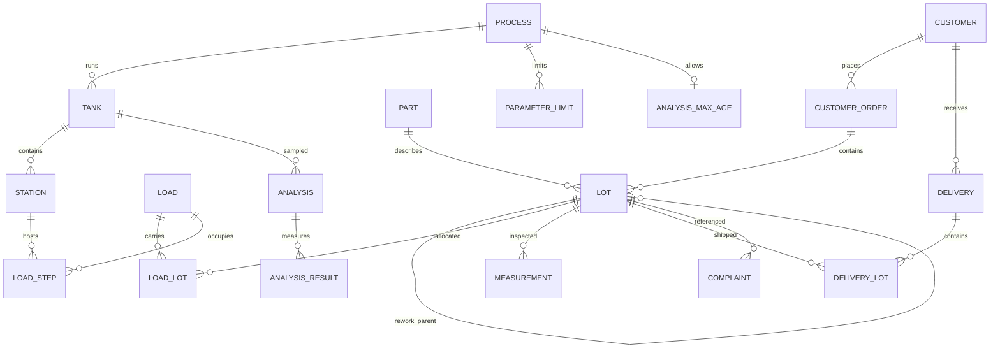

# Traceability model

`ref` holds anonymised customers, catalogue parts and the model line. `lab` holds versioned operating limits and bath analyses whose half-open validity ranges extend until the next sample. `trace` joins orders, lots, carrier runs, inspection and deliveries. `audit` records row changes. `bosch` holds a separate public-data track; its anonymised ticks are not mixed with simulation dates.

Backward tracing includes ancestors of a rework lot. It reads `trace.v_dwell_evidence`, which gives every plating dwell one row per analysis in force and parameter, plus NO_ANALYSIS rows for uncovered parts of the dwell; MISSING, STALE and NO_LIMIT make incomplete evidence visible (README, "Missing bath evidence"). `trace.v_unknown_exposure` lists the lots plated under such evidence, separately from containment.

Forward tracing starts with every load overlapping a bad bath period, includes descendants, and joins actual delivery quantities. Shipped rows are attributed to the delivery note's customer; the ordering customer is kept as a column. The customer report deduplicates lots across bad periods, separates directly plated lots from descendants, and counts affected pieces once per genealogy (a lot's quantity counts unless its parent is already affected).

GiST exclusions reject overlapping station occupancy and overlapping analysis validity. A tank-row lock serializes normal timeline insertion; out-of-order and duplicate samples are covered by integration tests. Timeline keys and validity ranges cannot be changed in place; only the `SECURITY DEFINER` timeline triggers adjust validity, and they refuse to run on any table other than `lab.analysis`. A deleted analysis hands its period back to the previous sample, but no application role may delete analyses. Limit versions can only be closed, and quality can start or close one only from today onwards.

Constraint triggers add the cheap consistency rules: a delivery note goes to the customer who ordered the lot; a child lot keeps its parent's part and customer, children never hold more pieces than their parent, and the genealogy has no cycles (checked at commit); a dwell step lies within its carrier run. The checks read the rows as they are when they run, so a deferred check at commit ignores a row deleted earlier in the transaction.

Audit triggers use a fixed search path and an owner context so restricted roles can write audited rows without write access to the audit table; the audit function refuses tables outside the project schemas and is not executable by application roles, so it cannot be attached to a temporary table. Each row stores the login (`login_user`) and the application-supplied `app.user` label (`changed_by`), which is not an authenticated identity. Database owners can alter records and audit logs. Use individual login roles and protected operational logs for a production deployment.

The simulator respects barrel mass and avoids physical-carrier overlap; the schema's carrier exclusion applies to a `load_id`, not the reusable carrier number. A cross-run carrier inventory constraint, quantity conservation across carrier allocations and deliveries, and part mixing within a carrier are not enforced by the database. This is a portfolio demonstration, not a production MES.
